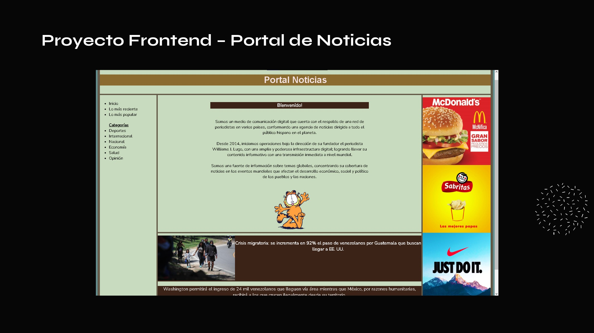

# Portal Noticias — Maquetación Frontend

Maquetación web estática de un portal de noticias digital, enfocada en el diseño adaptable (*responsive*), la estructura con **CSS Grid** y efectos visuales interactivos en **CSS3/SCSS**.

## Vista previa

## Características principales

- Maquetación estructurada con **CSS Grid** (*header*, menú lateral, contenido principal, noticia destacada, barra lateral y pie de página).
- Menú lateral de navegación y categorías informativas (*Deportes*, *Internacional*, *Nacional*, *Economía*, *Salud*, *Opinión*).
- Sección de bienvenida con animación de imagen al pasar el cursor y bloque de noticia destacada con efecto *hover*.
- Barra lateral con tarjetas giratorias en 3D (*flip cards*) y enlaces externos.
- Diseño adaptable (*responsive*) mediante *media queries* para móvil, tableta y escritorio.

## Tecnologías utilizadas

- **HTML5**
- **CSS3** (CSS Grid, Flexbox, animaciones y transformaciones 3D)
- **SCSS** (variables y *media queries* compiladas a CSS)
- **Google Fonts** (vía CDN)

## Contexto y estado del proyecto

- **Contexto:** Proyecto frontend estático desarrollado en 2022 con fines académicos.
- **Estado:** Finalizado (archivado para portafolio).

## Autor

**Daniel Alejandro Arita Leiva**
